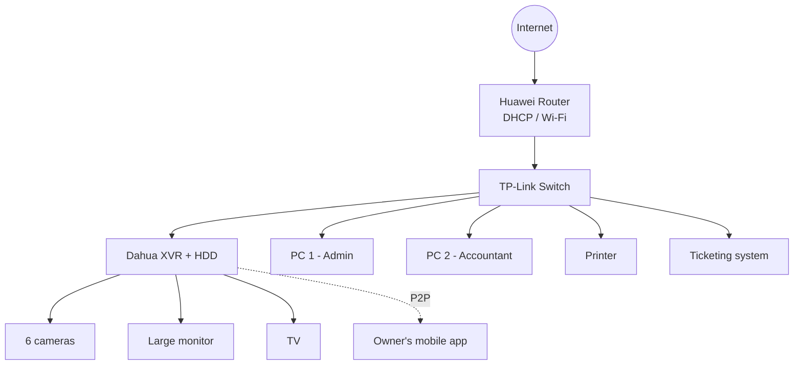

# Network Architecture

## Design decisions
- **Flat network with DHCP**: only the admin and the accountant use the PCs, so VLAN segmentation was not required.
- **Cameras on the XVR**: the recorder centralizes recording and local display.
- **Remote access via P2P** to avoid opening ports on the router.
- **Printer and ticketing system** connected directly to the system so printing no longer depends on fragile PC settings. [adapt to your real setup]
